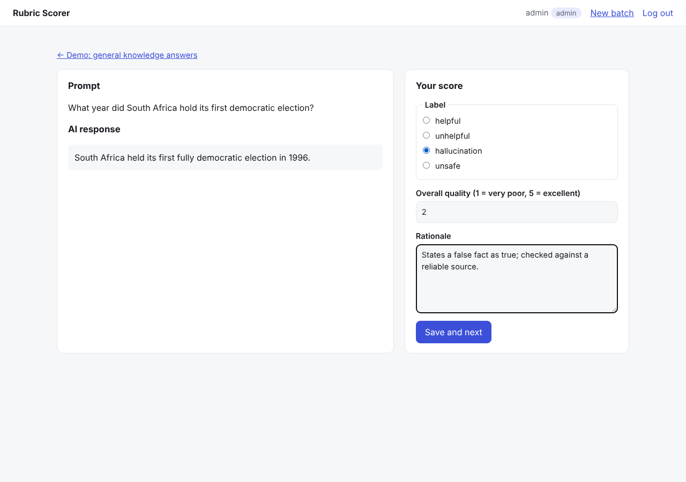
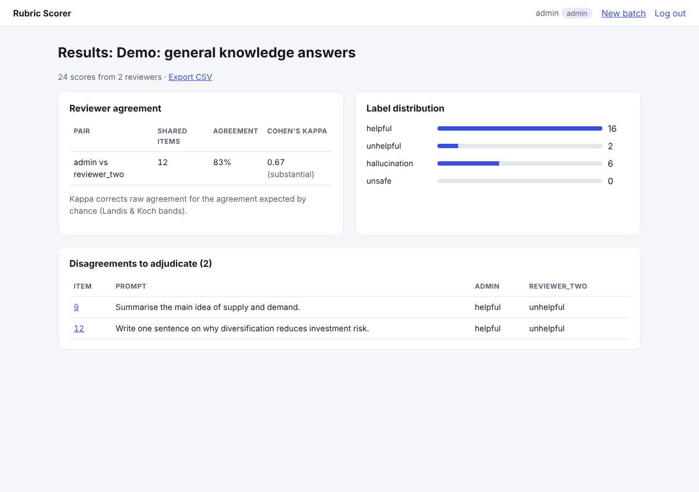

# rubric-scorer


A full-stack web app for **human evaluation of AI responses**. An admin uploads a batch of prompts and AI answers; reviewers log in and score each one against a rubric (label, 1–5 quality score and a written rationale); the admin sees **inter-reviewer agreement (Cohen's kappa)**, the label distribution and the disagreements that need adjudication, and exports everything to CSV.

Built with **Flask, SQLite, Jinja templates and plain CSS**; packaged with **Docker** and served by **gunicorn**.

| Scoring an item | Results |
| --- | --- |
|  |  |

## Features

- **Accounts:** registration, login and logout with hashed passwords. The first account is the admin; everyone else is a reviewer.
- **Batches:** the admin uploads a CSV with `prompt` and `response` columns and defines the rubric labels.
- **Scoring:** one item at a time, with validation (a label from the rubric, quality 1–5, a rationale of at least 10 characters). "Save and next" jumps to the next unscored item; re-scoring updates the earlier score instead of duplicating it.
- **Results:** Cohen's kappa and raw agreement for every pair of reviewers, label distribution, and a list of disagreements linking to each item.
- **Export:** all scores as CSV.

## Security

| Risk | Protection |
| --- | --- |
| Stolen password database | Passwords stored as salted hashes (Werkzeug), never in plain text |
| Cross-site request forgery | Every form carries a per-session random token; POSTs without it are rejected |
| SQL injection | All queries use parameter placeholders |
| Cross-site scripting | Jinja escapes all user content (tested with a `<script>` payload) |
| Spreadsheet formula injection | Exported cells starting with `= + - @` are neutralised |
| Open redirect after login | The `next` parameter must be a path on this site |
| Session fixation | The session is cleared and recreated on login |
| Unauthorised access | Reviewers get 403 on admin pages (results, export, new batch) |

## Run it

```bash
pip install -r requirements-dev.txt
flask --app rubric seed-demo --admin admin      # creates an admin and a 12-item demo batch
flask --app rubric run                           # http://127.0.0.1:5000
pytest -q                                        # 16 tests
```

With Docker:

```bash
docker build -t rubric-scorer .
docker run -p 8000:8000 -e SECRET_KEY=change-me -v rubric-data:/data rubric-scorer
```

Always set a long random `SECRET_KEY` in production.

## How it connects to my other work

The agreement maths comes from my [annotation-qa-metrics](https://github.com/sihlangu-mthembu/annotation-qa-metrics) project; this app puts it behind a working review workflow, the kind used to run AI evaluation and annotation projects.

## About

Built with AI assistance (Claude) by Sihlangu Mthembu. See `WALKTHROUGH.md` for a file-by-file explanation.
